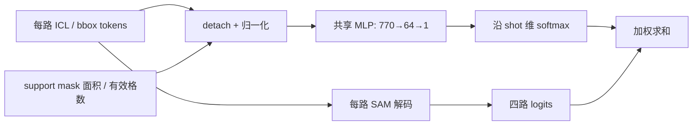

# 4-shot support 可靠性融合：第一版设计规格

评分头已接入训练、训练内valid、独立测试和诊断脚本。
默认 `SUPPORT_FUSION=mean` 保留四路logits等权平均；显式设为quality开启学习权重。

## 运行

在TBD目录、项目的Python环境中执行：

```bash
# 全局max + 两处attention屏蔽 + 学习质量权重；GPU编号按服务器调整。
GPU_ID=0,1 SUPPORT_MASK_POOLING=max SUPPORT_FUSION=quality \
BBOX_SUPPORT_ATTN_MASK=1 ICL_SUPPORT_ATTN_MASK=1 bash train_joint.sh

# 对照组：其他设置相同，等权融合。
GPU_ID=0,1 SUPPORT_MASK_POOLING=max SUPPORT_FUSION=mean \
BBOX_SUPPORT_ATTN_MASK=1 ICL_SUPPORT_ATTN_MASK=1 bash train_joint.sh
```

脚本按GPU_ID中的卡数自动设置进程数，默认仍为1,2两张卡。对照实验保持卡数和batch相同：
改变卡数会改变每轮优化步数，当前验证的类别/support抽样也依赖rank数。
其他服务器的数据路径仍由脚本中的JOINT_SUBDATASETS指定。

默认quality实验名：
`trn_joint4_shot4_cb0.5_poolmax_bboxm1_iclm1_fusionquality_qw0.1_qt0.2_fw2_fr3`。

|环境变量|默认|对应CLI|
|---|---|---|
|SUPPORT_FUSION|mean|--support-fusion|
|FUSION_QUALITY_WEIGHT|0.1|--fusion-quality-weight|
|FUSION_TARGET_TEMPERATURE|0.2|--fusion-target-temperature|
|FUSION_WARMUP_EPOCHS|2|--fusion-warmup-epochs|
|FUSION_RAMP_EPOCHS|3|--fusion-ramp-epochs|

延续原来的300轮学习率日程、8000 episodes/epoch和逐轮验证。两组同seed从头训练，
先观察同epoch结果；默认不开启逐shot分割辅助损失。

## 接入位置

训练和训练内验证分别为每个 support 生成50个 ICL tokens、2个 bbox tokens，
分别经过SAM解码，得到 `[B,S,H,W]` logits，然后取shot均值。
quality模式将最后一步替换为 `sum_s(alpha_s * logits_s)`，每个support一个标量权重。
SAM图像编码仍可对同一query复用；评分分支不需要新增图像编码次数。

`model/base/support_fusion.py` 提供统一的 `decode_support_logits` 和
`fuse_support_logits`。`train.py` 的训练、valid分支及 `predict_mask_nshot`
均调用它们：每路保留独立52个tokens、分别解码，最后按相同规则融合logits。
SAM图像embedding只按query编码/读取一次，再重复到shot维度。
独立测试原先的平均tokens路径已删除，返回张量的形状和调用签名保持兼容。

用户当前评估使用 `train.py` 的valid分支，这条路径的数学计算和既有mean指标含义不变。
修复会改变旧独立 `test.py` 的聚合行为；不能将其结果变化归因于评分头。

## 第一版评分分支

- 在所有shot之间共享同一个轻量MLP，产生未限幅的分数 `r_s`，对shot维做softmax。
- 首选输入：每路query条件化的ICL token汇聚、保留TL/BR顺序的两个bbox tokens、
  support已知mask的面积和实际特征网格有效格数。
- 这些输入均不依赖query GT；query cross attention仍使用完整query上下文。
- 先采用每shot标量权重，避免同时增加逐像素融合和多尺度分支。
- 不把前景面积或多数support间的一致性单独当作可靠性标签；三个错误预测可能
  达成一致。min-max归一化pseudo的最大值通常恒为1，也不适合直接当匹配质量。
- SAM原生IoU输出当前未接入本任务的逐shot质量监督，使用前需要校准和验证。

具体张量规格（N=B*S，C=256）：

|输入|处理|每个support的维度|
|---|---|---:|
|ICL tokens `[N,50,256]`|token维平均，再做LayerNorm(256)|256|
|bbox tokens `[N,2,256]`|按TL、BR顺序展平，再做LayerNorm(512)|512|
|support原始输入mask面积A|`log(1+A)/log(1+H*W)`|1|
|实际下采样mask有效格数G|`log(1+G)/log(1+h*w)`|1|
|合计||770|

两项mask统计使用增强后的输入mask和本次forward已经得到的下采样mask，
不使用数据集/类别ID硬编码。网格尺寸取真实h,w，不固定写死64。

评分网络：`770 → Linear(64) → SiLU → Linear(1)`，加上两个LayerNorm共
**50,945个参数**。最后一层权重和偏置初始化为0，使初始四路权重严格相等。
第一版输入特征先detach：质量监督不直接修改原prompt特征表示，原分割梯度
仍通过每路logits回到prompt/SAM模块。



## 质量监督与训练稳定性

训练时用query GT计算每路阈值化预测的Dice `d_s`（0–1），停止梯度后生成相对质量标签：

```text
binary_s = sigmoid(logits_s.detach()) > 0.5
d_s = 2 * intersection(binary_s, query_gt) / (area(binary_s) + area(query_gt))
beta = softmax(d / tau)
alpha_pred = softmax(r)
L_quality = KL(beta || alpha_pred)  # 每个query求KL，再对batch取平均
```

初始实验固定 `tau=0.2`、`lambda_quality=0.1`，属于待验证的起始配置。
例如一路Dice0.75、其余0时，监督权重约为0.934/0.022/0.022/0.022。
四路Dice全为0时，监督权重自然为均匀分布。
query增强后GT为空的样本跳过质量监督，避免把全背景预测当作目标质量；
原有分割损失策略单独保持一致。

```text
L_total = L_seg(fused_logits, query_gt)
        + 0.5 * L_bbox
        + 0.1 * L_quality
```

Dice标签和beta都停止梯度。L_quality只更新评分头；L_seg既通过权重更新评分头，
也通过各路logits更新原网络。推理权重仅由评分头产生，query GT只参与训练损失
或验证指标，不能进入评分forward。valid中的融合公式与训练保持一致。

用未限幅的r学习相对权重，避免将0–1质量分数直接做温度1的softmax：后一种方法
在4-shot中即使一项为1其余为0，最大权重也只有约0.475，未必能压过三个错误分支。

采用明确的短暂过渡期（epoch从0计数）：

|epoch|实际使用的权重|
|---|---|
|0–1|等权；评分头同时学习L_quality|
|2|`alpha = (2/3)/S + (1/3)*alpha_pred`|
|3|`alpha = (1/3)/S + (2/3)*alpha_pred`|
|4及以后|`alpha = alpha_pred`|

混合系数需要作为模型buffer保存到quality checkpoint，训练与valid用同一数值；
独立加载早期checkpoint时沿用保存值，避免验证/推理使用不同的权重规则。
是否增加逐shot分割辅助损失用于防止低权重分支缺少梯度，留作后续独立消融。
所有shot都很差时，融合未必有收益；GT选出的最佳单shot只作诊断参考。

mean模式不实例化评分头，旧权重可继续严格加载；quality模式的新增参数显式注册到
optimizer，在DDP的forward中计算并返回评分结果，参与后续损失。
checkpoint额外保存运行config、epoch和val_dice；评分头参数和mix buffer包含在model中。
`test.py` 与诊断脚本自动识别checkpoint的融合模式，并严格加载评分头及保存的mix。
显式指定与checkpoint不符的融合模式会报错；当前未增加从mean权重迁移到quality的训练入口。

每轮训练及每个数据集valid记录 `[Support fusion ...]`：quality_loss、mix、
归一化权重熵（均匀为1）、最大权重、各shot平均权重，以及按实际权重选择的单shot
Dice与最好单shot Dice。后两项是逐query诊断均值，不是日志中的类别汇总Dice。
这些统计跨rank求和后记录，TensorBoard位于 `fusion/train`、`fusion/val/amos` 等。
query增强后GT为空时质量项为0；loss按全部query的batch平均，以匹配DDP全局平均梯度。

## 目前的证据和后续消融

此前固定诊断子集上的面积平方根加权：ADAM Dice7.84→9.51，但门静脉
50.53→48.21；只选最大面积support导致门静脉降至32.70。
该检查使用旧adam-only+双attention屏蔽权重，不是全局max实验结果；
不应直接据此确定全局max模型的最优融合规则。

下一轮先保存全局max的等权基线，再在同一全局max配置下比较quality融合。
固定query/support、患者划分、验证清单、学习率日程及其他开关。
诊断覆盖ADAM两类、AMOS稀有类和肾上腺、BTCV小器官、BraTS三类；
逐数据集、逐类报告Dice、四路质量排序和权重分布，检查是否长期塌缩到某类support。
同时记录权重熵、最大权重、每路Dice与融合Dice：判断评分有没有识别到更好的support，
以及更高评分是否真正改善了融合。不要只用分割训练loss判断评分是否有效。
完整验证患者覆盖的评估方案需在所有对照方法中一致采用。

关键实现检查：mean与旧训练内验证数值一致、shot1退化一致、shot重排不改变融合结果、
训练与验证/独立测试共用同一聚合函数、推理不依赖query GT、新增参数确实得到梯度和更新。
